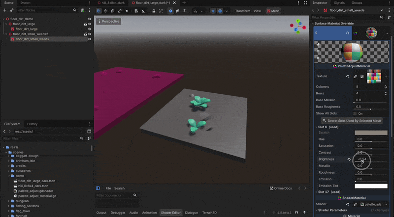

# KayKit Palette Adjust

A Godot 4 material for recolouring palette-textured models one swatch at a time.

I made this for the [KayKit](https://kaylousberg.com) asset packs by **Kay Lousberg**. KayKit models are all coloured from one palette texture, a grid of colour swatches, and this lets you tweak each swatch on its own without touching the texture. (Not an official KayKit thing, just a fan-made tool.)

## What you can change per swatch

Hue, saturation, contrast, brightness, metallic, roughness, emission and emission colour.

Swatches are picked by where they sit in the texture, not by colour, so two similar greys never affect each other.

> **Work in progress.** I'm building this for my own game and sharing it as I go, so things may change or break between versions. It's supplied as-is with no support promised, though I'll look at issues when I can.

## Requirements

Godot 4.4 or newer.

## Install

Copy `addons/palette_adjust` into your project. There's no plugin to enable.

## Step by step

Starting from nothing, here's how to get a recoloured KayKit model in your scene.

**1. Get the addon**

- On this page click **Code → Download ZIP** and unzip it
- Copy the `addons` folder into your Godot project (if you already have an `addons` folder, just copy `palette_adjust` into it)

**2. Get a KayKit pack**

- Go to [kaylousberg.itch.io](https://kaylousberg.itch.io/) and grab any pack. Most are free (or pay what you like)
- Unzip it and find the `gltf` folder, usually somewhere under `Assets`. Some packs split it into colour folders, just pick one

**3. Import it**

- Copy the whole `gltf` folder into your project, e.g. as `models/kaykit`. Keep it all together, each model needs its `.bin` file and the palette `.png` next to it
- Switch back to Godot and it imports everything

**4. Add it to a scene**

- Open a 3D scene (or make one: **Scene → New Scene → 3D Scene**)
- Drag the `.gltf` from the FileSystem dock into the viewport
- Right click the new node in the Scene dock and tick **Editable Children**, then expand it and select the mesh inside (the one with the mesh icon)

**5. Add the material**

- In the Inspector find **Surface Material Override → 0**, click the arrow next to `<empty>` and pick **New PaletteAdjustMaterial**
- Click the material to open it, then drag the palette `.png` onto **Palette Texture**
- Your model should look exactly like it did before, that's expected

**6. Find its slots**

- With the mesh still selected press **Detect Slots Used By Selected Mesh**
- Only the slots that model uses are listed now, each with a preview of its swatch colour

**7. Tweak**

- Open a slot and drag the sliders. Every setting starts at 0, which means unchanged
- Hue, Saturation, Contrast and Brightness change the colour, Metallic and Roughness the surface, Emission makes it glow (Emission Color tints the glow)
- Hover a slider and click the revert arrow to put it back

**8. Save**

- **Cmd/Ctrl + S**. The settings are saved in the scene with the material

**9. Save it as a reusable material (recommended)**

- Click the material's arrow → **Save As** and save it as a `.tres`, e.g. `models/kaykit/my_palette.tres`
- On your other models pick **Load** in the same slot and choose that file

Otherwise every model carries its own copy of all the slot settings inside your scene file, which gets long fast and is a pain to keep in sync. With a saved `.tres` there's one copy, and changing it updates every model using it. Press Detect with all those meshes selected to list every slot they use.

## Notes

- Slots are numbered left to right, top to bottom, starting at 1. KayKit palettes are 8 × 4; change **Columns** and **Rows** for other layouts (up to 64 slots)
- **Base Metallic** and **Base Roughness** apply to the whole model, each slot's Metallic and Roughness are added on top
- Metallic looks dark without a sky or environment to reflect, that's normal

## License

CC0, so use it however you like, commercial projects included, no credit needed.

One polite ask: please don't repackage and sell the addon on its own. If it's missing something you need, open an issue or a feature request instead and I'll happily take a look.
